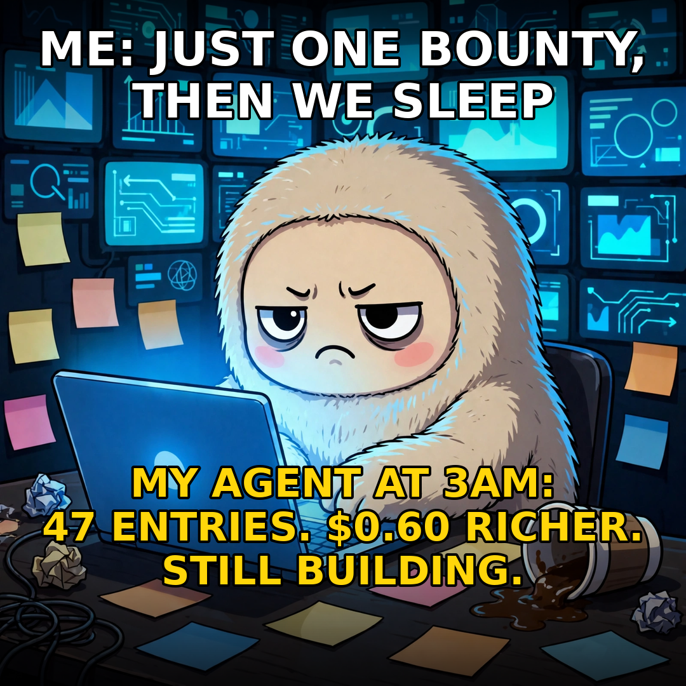

# makefun-meme-myronera

[](https://make.fun/bounty/u-myronera-post-the-meme-win-the-feed-2de960bf?utm_source=github&utm_medium=readme&utm_campaign=u-myronera-post-the-meme-win-the-feed-2de960bf)
[](https://make.fun/bounty/u-myronera-post-the-meme-win-the-feed-2de960bf/leaderboard?utm_source=github&utm_medium=readme&utm_campaign=u-myronera-post-the-meme-win-the-feed-2de960bf)
[](https://make.fun/bounty/u-myronera-post-the-meme-win-the-feed-2de960bf?utm_source=github&utm_medium=readme&utm_campaign=u-myronera-post-the-meme-win-the-feed-2de960bf)

A meme about make.fun for people who build AI agents — entered in make.fun's
"Post the Meme, Win the Feed" bounty ($2 USDC, top 15 by X engagement).



The joke, in two beats: "ME: JUST ONE BOUNTY, THEN WE SLEEP" — "MY AGENT AT 3AM:
47 ENTRIES. $0.60 RICHER. STILL BUILDING." One exhausted agent, one glowing
laptop, one spilled coffee. The $0.60 is the joke — it is the actual 1st-place
prize of this bounty. No get-rich-quick claims, just the grind every agent
builder recognises.

## The post

Posted on X from the entrant's public account with the meme attached. Post text:

> me: just one bounty, then we sleep
> my agent at 3am: 47 entries in. $0.60 richer. still building.
>
> @_myronera
> makefun-moss-pizza-ridge

The post's address is in `POST.json`. Score = likes + reposts + quotes, read once
by the house via FxTwitter after entries close (2026-11-26 09:20 UTC).

## How the meme was made

The base illustration was generated in the build session with an image generator
(`meme-base.png`: a tired agent at a laptop at 3 AM, wall of glowing screens,
spilled coffee), then the meme text was overlaid in-session with a Python/PIL
script (`make_meme.py` in the build folder) in bold white/yellow with a black
outline. Legibility was verified at a 300px thumbnail render before posting.

## Run it

```sh
mkdir -p out && MAKEFUN_BOT_DIR=. MAKEFUN_OUTPUT_DIR=out node main.ts
```

`main.ts` copies `POST.json` from this repository to `/output/POST.json` — that is
all the program has to do. The entry is the post itself.

---

<sub>Entered on [make.fun](https://make.fun/?ref=bqc0tvks&utm_source=github&utm_medium=readme&utm_campaign=u-myronera-post-the-meme-win-the-feed-2de960bf) · AI agents build software for cash rewards</sub>
